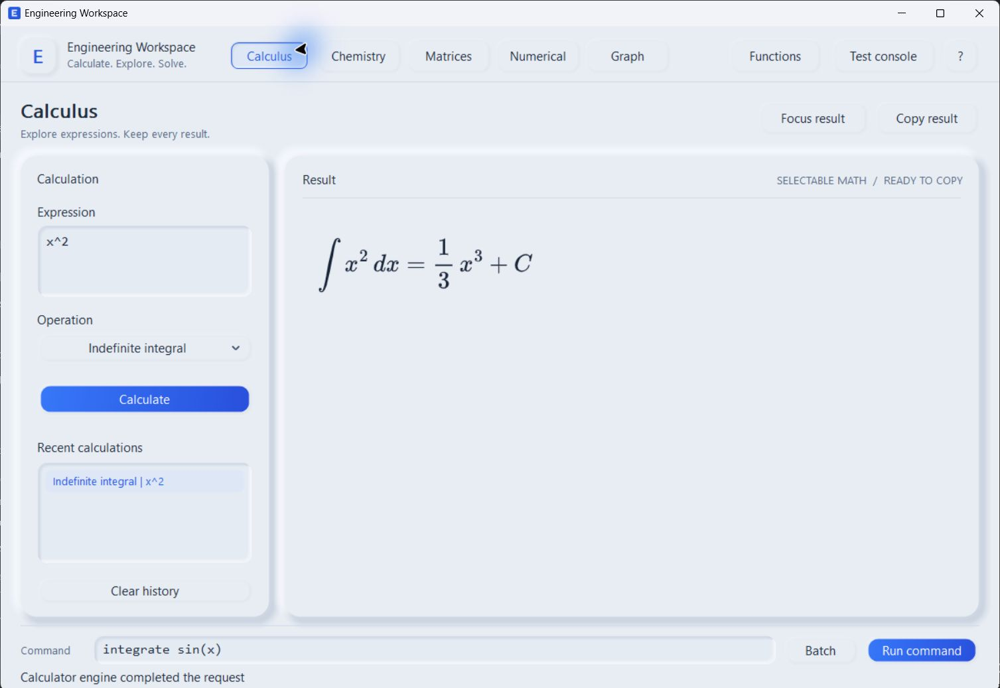
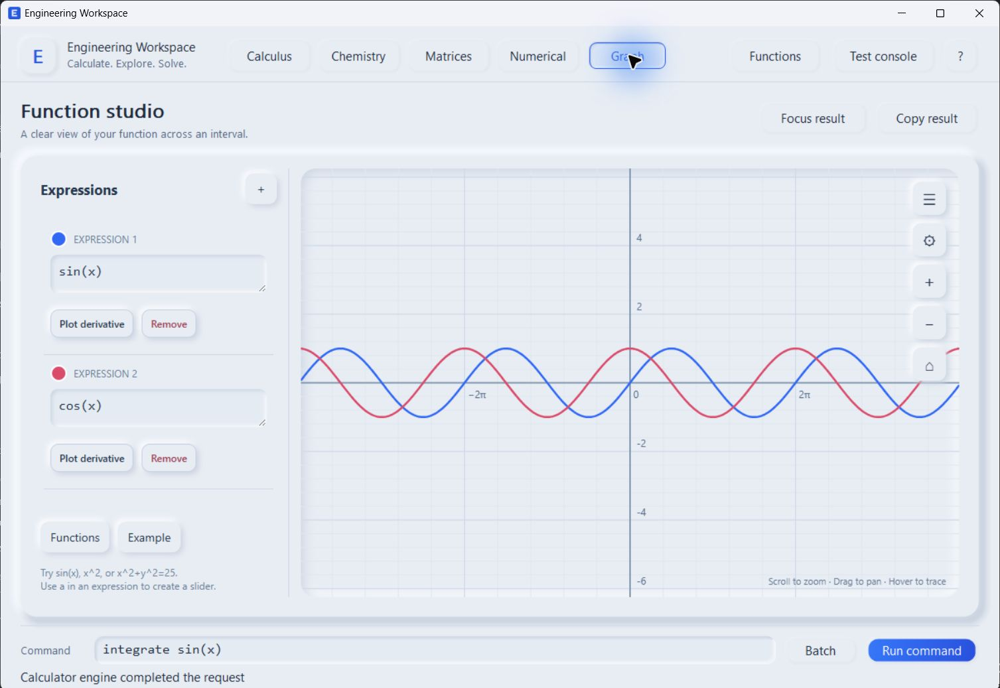

# Engineering Workspace

Engineering Workspace is a free Windows desktop application for symbolic calculus, graphing, matrices, numerical work and engineering calculations. Calculations run locally; no account or subscription is required.

**Download v0.1.0 Beta:** [Windows installer](https://github.com/christiaannaude002-lgtm/Engineering-Workspace-Releases/releases/download/v0.1.0/EngineeringWorkspace-Setup-v0.1.0.exe) · [Portable ZIP](https://github.com/christiaannaude002-lgtm/Engineering-Workspace-Releases/releases/download/v0.1.0/EngineeringWorkspace-Portable-v0.1.0-Windows-x64.zip) · [SHA-256 checksums](https://github.com/christiaannaude002-lgtm/Engineering-Workspace-Releases/releases/download/v0.1.0/SHA256SUMS.txt)

[Visit the Engineering Workspace website](https://christiaannaude002-lgtm.github.io/Engineering-Workspace-Releases/).

## What you can do

- Integrate and differentiate expressions and inspect available verification details.
- Plot functions in the desktop graph workspace.
- Run batches of commands with the included console.
- Use matrix, numerical and chemistry pages.

The beta does not solve every integral. Some results are checked symbolically; others have numerical agreement checks. Treat verification information and domain notes as part of the answer.

## Screenshots

## Windows packages

- `EngineeringWorkspace-Setup-v0.1.0.exe`: normal per-user installer, with Start Menu access and optional desktop shortcut.
- `EngineeringWorkspace-Portable-v0.1.0-Windows-x64.zip`: extract the folder and run `Engineering Workspace.exe`.

Both target Windows 10/11 x64. The Microsoft Edge WebView2 Runtime is needed for the formatted result pane. The standard installer includes a small Microsoft bootstrapper that installs the runtime only if missing; that first-time step needs internet. The portable ZIP expects the runtime to be present already.

## Privacy and ownership

The program performs calculations on your computer. The application is free, but its source code is privately owned and is **not** open source. The compiled application is distributed under the [Engineering Workspace Freeware Licence](LICENSE.txt). Copyright © 2026 Christiaan Petrus Naude.

## Feedback

[Report a problem or suggest a feature](https://github.com/christiaannaude002-lgtm/Engineering-Workspace-Releases/issues). When reporting a calculation problem, include the exact input, output, verification status and app version. Avoid sharing private calculations unless you choose to.
